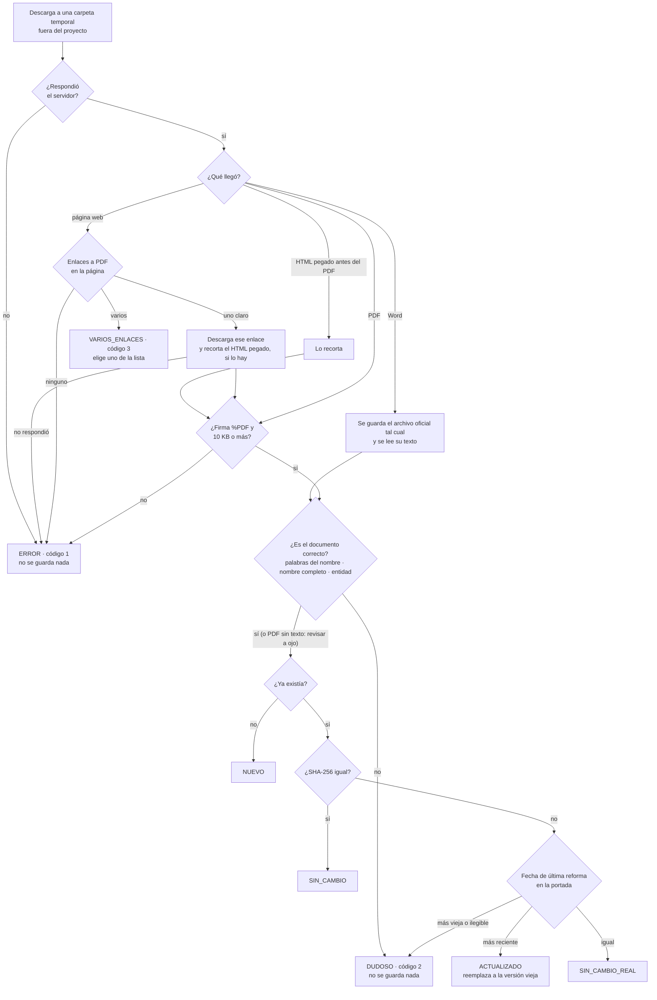

# ACTUALIZAR: cómo decide `descargar`, trampas conocidas, portales y calendario

> Referencia del manual `AGENTS.md` (secciones 5, 7, 11, 12 y 13). Consúltala cuando algo falle **antes** de buscar a
> ciegas. Contenido: 1. cómo decide `descargar` cada resultado · 2. trampas conocidas de los portales y su solución ·
> 3. portales oficiales de los 32 estados · 4. calendario de cambios (qué revisar primero).

## 1. Cómo decide `descargar` si un documento es nuevo

1. **Descarga a una carpeta temporal propia de esa ejecución**, fuera del proyecto (en la carpeta
   temporal del sistema) y nunca directo a la biblioteca; esa carpeta se borra sola al terminar, aunque
   haya un error o se interrumpa. Usa User-Agent de navegador y,
   si hace falta: certificados de `certifi`, la misma URL sin `www.`, `https://` en vez de `http://` y,
   como último recurso, el `curl` del sistema (que completa cadenas de certificados incompletas).
   Codifica acentos y espacios de la URL. Nunca desactiva la verificación de certificados.
2. **¿Es PDF real?** La firma `%PDF` debe estar en el primer kilobyte. Un HTML guardado como `.pdf`
   se rechaza (el tamaño NO sirve para detectarlo: hay páginas de error de 100 KB). Si el portal pegó
   HTML **antes** de un PDF completo (Nayarit), lo recorta desde `%PDF` hasta el último `%%EOF` y avisa.
   Si es una página, busca dentro el enlace al PDF: si hay uno claro lo sigue; si hay varios, los
   lista (código 3). Un PDF de menos de 10 KB se rechaza salvo `--permitir-pequeno`.
   **Fuente oficial en Word.** Si llega un **Word** (`.doc` o `.docx`, reconocido por su firma interna y no por
   la extensión), se guarda ESE archivo tal cual, sin convertirlo, en la carpeta de su grupo y con su extensión real
   (`biblioteca/PDF/Estados/Baja_California_Sur/Ley_de_Salud_para_el_Estado_de_Baja_California_Sur.doc`). Su huella
   (SHA-256) es la del archivo oficial: cualquiera puede descargarlo y comprobarla. El texto para las
   revisiones se lee con el lector de Word propio (`biblioteca.py word`). **Una página web nunca se guarda**: la
   biblioteca solo guarda PDF o Word (AGENTS.md, regla 13).
3. **¿Es el documento correcto?** Se revisa en la **portada** (lo que va antes del artículo 1 real; el
   cuerpo de una ley suele citar a otras):
   - al menos el 50 % de las palabras clave del nombre;
   - en leyes, códigos, reglamentos, constituciones y estatutos, el **nombre completo** en orden (sin
     contar "de", "para el", "del"...) y que **ningún otro documento del catálogo** del mismo ámbito
     (con nombre oficial) aparezca antes; la Constitución no cuenta como competidora. Así se detecta la
     ley SUSTITUTA o una ley que solo CITA a la buscada (el art. 1 de la Ley Aduanera cita al CFF);
   - en documentos estatales, que las primeras páginas **mencionen la entidad**.
   Medido con 92 PDF correctos y 1,823 cruces: 4 falsas alarmas (nombres inexactos del catálogo →
   `renombrar`) y 4 cruces aceptados (preámbulos que citan otra ley). No distingue sustituciones de
   nombre casi idéntico ("para el Estado" → "del Estado"): para eso, `--revisar --buscar "abroga"`.
   **Excepciones:** PDF escaneado (sin texto: se guarda con aviso y se revisa a ojo); `--forzar` (no se
   aplican las revisiones y, si el SHA-256 difiere, reemplaza aunque la fecha sea igual, ilegible o MÁS
   VIEJA); y una alarma del NOMBRE ya confirmada con `--forzar` para esa misma URL, que no se repite
   mientras sea idéntica (las de palabras y entidad sí se repiten).
4. **¿Cambió?**
   - No había archivo → `NUEVO`.
   - SHA-256 igual al guardado → `SIN_CAMBIO`.
   - SHA-256 distinto → compara la **fecha de "última reforma"** de la portada (entiende "Última Reforma DOF
     09-04-2026", "última reforma publicada ... el 15 de marzo de 2025", "17 MAYO 2025", "1o. de enero
     de 2024", "ÚLTIMA ENMIENDA PUBLICADA...", la tabla "Historial de cambios" de las Fichas
     Genealógicas de Querétaro, "Última actualización/modificación…" (Veracruz, Guerrero, Zacatecas…), el
     encabezado "Reforma: P.O. … DD-MM-AAAA" de Guanajuato, la tabla de reformas del Orden Jurídico Poblano y,
     en leyes federales sin reformas, "Nueva Ley DOF 18-03-2025"; nunca "texto vigente a partir del…"; si
     varias fechas siguen al rótulo toma la más reciente, salvo que vengan en columnas con otros
     rótulos como "fe de erratas" o "abrogación"):
     más reciente → `ACTUALIZADO`; igual → `SIN_CAMBIO_REAL`; más vieja o ilegible → `DUDOSO`.
     Si llega otro formato con la MISMA reforma (el Word frente a un PDF oficial guardado), se conserva el
     guardado y también su URL: el registro sigue diciendo de dónde salió ese archivo. Para reemplazar una
     copia de otro sitio por el Word oficial, `--forzar`; el archivo del formato anterior se borra.
5. **Registra**: guarda el PDF en su lugar de la estructura única, `PDF/<grupo>/<archivo>.pdf`
   (`sistema/referencia/estructura.md`; si el documento no la cumple, se detiene sin escribir nada), y anota en el
   manifiesto (archivo, SHA-256, bytes, URL, fecha de reforma, fecha de descarga y de verificación),
   la URL como primera pista en el catálogo (así la próxima vez ya se sabe dónde está) y la bitácora.
   Durante el proceso, la versión reemplazada se guarda en `anteriores/`, en la carpeta temporal del sistema (se borra al cerrar
   con `verificar --limpiar`). El Markdown queda **pendiente**: la
   conversión es un proceso aparte que se ofrece al usuario al final.

Todo esto se hace con un **candado del sistema operativo** sobre el archivo `candado` de la carpeta de datos del
usuario (el archivo no se borra; el sistema suelta el candado al terminar el proceso): varios agentes pueden descargar a la vez sin pisarse, y si un proceso
muere el sistema suelta el candado solo. Guardar el catálogo, el manifiesto o un PDF es atómico: una
interrupción nunca deja un archivo a medias, y si el manifiesto no se pudo guardar se deshace el cambio
del PDF. Si la ficha del manifiesto no coincide con el PDF guardado, un SIN_CAMBIO la corrige.

### Descarga robusta sin bajar la seguridad (`sistema/herramientas/descargar.py`, con `requests`)

- User-Agent de navegador; acentos y espacios de la URL codificados; solo `http://` y `https://`.
- Hasta 3 reintentos con espera creciente (2, 6 y 18 s, ±25 %) ante 429, 500-504 y cortes de red, respetando
  `Retry-After`; los demás 4xx no se reintentan.
- Respaldos, en orden: sin `www.`, con `https://` y, solo ante certificados incompletos, el `curl` del sistema
  (que usa el almacén del sistema operativo). Nunca se desactiva la verificación de certificados.
- Límites: 15 s para conectar, 120 s sin datos, 30 minutos en total (reintentos incluidos) y 1 GiB por archivo
  (por `Content-Length` o por bytes recibidos); un archivo parcial nunca se queda.
- Ctrl+C detiene la descarga al instante, aunque el servidor se haya quedado callado.

### Lectura de la fecha de última reforma (`sistema/herramientas/descargar.py`)

Formatos que entiende (todos con pruebas en `pruebas/test_descargar.py`): "Última Reforma DOF 09-04-2026"; "última
reforma publicada … el 15 de marzo de 2025", "ÚLTIMA REFORMA … 17 MAYO 2025" y "… el 1o. de enero de 2024";
"ÚLTIMA ENMIENDA PUBLICADA…" (Nayarit); la tabla "Historial de cambios" de las Fichas Genealógicas (Querétaro),
aunque ocupe varias páginas; "Nueva Ley DOF 18-03-2025" (leyes federales sin reformas); "Última actualización: 8 de
octubre de 2025" (Veracruz, Aguascalientes, Zacatecas); "Últimas modificaciones / adiciones publicadas en el
Periódico Oficial…" (Guerrero, Campeche); "Reforma: P.O. núm. 252; 18-12-2025" en el encabezado (Guanajuato: la más
reciente de todas sus líneas) y la tabla "REFORMAS / Publicación" del Orden Jurídico Poblano (Puebla). Nunca "Texto
vigente a partir del…" (es entrada en vigor, no reforma) ni fechas futuras. Si hay varias fechas después del rótulo,
toma la más reciente, salvo que vengan en columnas con otros rótulos ("fe de erratas", "fecha de abrogación"). La
abrogación no cuenta ("Última reforma DOF 12-01-2016 Ley Abrogada DOF 09-08-2019" → 2016); una fe de erratas
posterior sí (cambia el texto: así una versión corregida sale ACTUALIZADO). Si la portada no trae la fecha o la
herramienta la lee mal, el agente la indica con `--reforma AAAA-MM-DD` tras leerla en el documento o en el listado
del portal: manda sobre la leída (avisa si difieren) y también corrige la ficha de un documento ya guardado
(resultado SIN_CAMBIO). En un lote, la fecha va como tercera columna: `id URL AAAA-MM-DD`.

### Códigos de salida de `descargar`

Guíate siempre por la línea `RESULTADO:` (con `--json`, por el campo `resultado`).

| Código | Significa |
|---|---|
| `0` | NUEVO, ACTUALIZADO, SIN_CAMBIO, SIN_CAMBIO_REAL o REVISADO (con `--revisar`) |
| `1` | ERROR: no se pudo descargar, o no es un PDF ni un Word con texto. También sale 1, con una línea `ERROR:` y sin `RESULTADO:` (y sin quedar en la bitácora), si el id no existe, si el documento está marcado `no_existe`/`no_localizado`, si el `--archivo` no existe, si no se indicó URL ni `--archivo`, si falta pdfminer o si el candado sigue ocupado demasiado tiempo |
| `2` | DUDOSO: no se guardó nada; el agente revisa el motivo |
| `3` | VARIOS_ENLACES: la URL era una página con varios PDFs posibles |
| `64` | Error de uso (opción mal escrita, `--buscar` sin `--revisar`, `--origen` sin `--archivo`), sin `RESULTADO:` y con el mensaje en stderr. Todas las herramientas devuelven 64 ante un error de uso |
| `130` | Interrumpido con Ctrl+C o Ctrl+Break (todas las herramientas que pasan por `comun.ejecutar`) |

La bitácora registra NUEVO, ACTUALIZADO, SIN_CAMBIO, SIN_CAMBIO_REAL, DUDOSO y ERROR; no registra REVISADO,
VARIOS_ENLACES ni los errores de uso.

## 2. Trampas conocidas (aprendidas construyendo la biblioteca)

### Al descargar

| Síntoma | Causa | Solución |
|---|---|---|
| La "descarga" pesa 100 KB y no es PDF | El servidor devolvió una página HTML (envoltorio, error, visor) | `descargar` lo detecta por la firma `%PDF`; busca la liga directa o pásale la página para que extraiga el enlace |
| El servidor responde `application/pdf` pero `descargar` veía HTML | El portal pega una página HTML antes del PDF real (Nayarit) | `descargar` ya recorta desde `%PDF` hasta el último `%%EOF` y avisa |
| Se guardó una versión vieja como NUEVO | La URL de la pista sigue respondiendo con una versión anterior; la vigente tiene otro nombre (p. ej. `...-1.pdf`) | Toma la URL del listado del portal o del índice de Diputados, no la pista (AGENTS.md §7 paso B) |
| La primera pista descarga la ley SUSTITUTA | La investigación dejó la URL de la ley nueva en la ficha de la vieja | `descargar` avisa si el nombre completo no aparece; revisa transitorios y aplica el paso E |
| 404 en una URL de Diputados que antes funcionaba | La ley se reformó y el archivo cambió de nombre (`pdf/` → `pdf_mov/`, sufijo de fecha) | `buscar diputados "<nombre>"` siempre da la vigente |
| Error de certificado | El portal envía su cadena de certificados incompleta (pasa en varios estados) o `www.` mal configurado | `descargar` ya prueba certifi, sin `www.` y `curl` del sistema. Nunca `--insecure` |
| URL con acentos o espacios falla | Nombres de archivo como `Código Civil.pdf` | `descargar` los codifica solo |
| El listado del portal no muestra enlaces | Se carga con JavaScript, o el enlace es un ícono sin texto en otra celda | `buscar enlaces` ya toma el texto de la fila; si aun así no hay, usa tu herramienta web |
| El portal bloquea descargas automáticas | Filtros anti-robots | Descarga por otro medio y registra con `--archivo --origen <URL oficial>`, o usa el periódico oficial. Nunca la copia de un sitio no oficial |
| La ley de otro estado con el mismo nombre | Muchos estados tienen "Código Civil del Estado de ..." | `descargar` exige que el PDF mencione la entidad |
| SHA-256 distinto pero mismo contenido | El servidor regenera el PDF con otra marca de tiempo | `descargar` compara la fecha de reforma: `SIN_CAMBIO_REAL` |
| Ley sustituida por otra | Reformas estructurales (p. ej. leyes de energía 2025) | `AGENTS.md` §7 paso E: marcar la vieja `abrogado` y `agregar` la nueva |
| Ley renombrada (misma ley, nombre nuevo) | Un decreto cambió su denominación (p. ej. "Vida Libre de Violencia" -> "Violencias") | `catalogo renombrar <id> --nombre ... --nota ...` |
| Documento de un año específico (RMF 2026) | Se sustituye cada año | `AGENTS.md` §11 (calendario) |
| La versión vigente solo está en Word (`buscar enlaces` marca la fila "[WORD, no es PDF]") | Algunos portales (Querétaro, BCS) publican la última reforma solo en .doc, o el PDF quedó más viejo que el Word | `descargar <id> <URL del .doc>`: reconoce el Word por su firma y lo guarda tal cual en `biblioteca/PDF/<grupo>/` (con su extensión `.doc`); su texto sale con MarkItDown o `word`. Si hay PDF oficial con la MISMA reforma, se conserva el PDF |
| El documento oficial solo existe como página web (HTML), sin PDF ni Word | P. ej. la lista cronológica de reformas constitucionales (`ref/cpeum_crono.htm`) | **No se guarda** (solo PDF o Word). Busca su PDF o Word en otra fuente oficial: para la lista cronológica se guarda el sumario oficial en PDF de Diputados (`sumario/CPEUM_sumario_crono.pdf`), aunque esté congelado, con nota. Si no hay ninguno, repórtalo |
| Una pista del catálogo resultó ser de OTRO documento | Dato viejo o de la investigación | `catalogo pista <id> --url <url> --quitar` |
| Un reglamento federal no aparece en `buscar diputados ... --reglamentos` | El índice `regla.htm` no enlista todos los reglamentos; varios viven en `LeyesBiblio/regla/nNNN.pdf` y los de tránsito/autotransporte en `LeyesBiblio/norma/reglamento.htm` (a veces solo `.doc`; cambiar `.doc` por `.pdf` funciona solo a veces) | Usa la pista del catálogo (`catalogo ver <id>`) o `buscar enlaces <esa página>`; si murió, busca en el sitio de la dependencia (p. ej. SICT) o en el DOF |
| `buscar diputados` no encuentra una ley abrogada ni un "Decreto de reforma" | Solo consulta el índice de leyes vigentes | Abrogadas: `buscar enlaces https://www.diputados.gob.mx/LeyesBiblio/abroga.htm --limite 300 --filtro "<nombre>"` (los PDF viven en `LeyesBiblio/abro/<sigla>/`). Decretos de reforma constitucional: usa las pistas del catálogo o `buscar enlaces` sobre `.../ref/cpeum_crono.htm` |
| `buscar enlaces` muestra pocas filas o "parece que falta la ley" | Por defecto muestra 80; la cabecera dice "se muestran los primeros N". `--todos` NO levanta el límite y suma enlaces que no son documentos | `--limite 2000`, `--filtro "palabras"` (sin acentos, dentro de la herramienta, no con `grep`) y `--solo-pdf` |
| El listado no trae enlaces útiles (Angular/Astro, API JSON, anti-bot Sucuri, acordeones) | El HTML estático no contiene las leyes | `curl` a la API JSON del portal (con User-Agent de navegador) o el **navegador integrado** del editor (`fetch` + `DOMParser`); luego `descargar <id> <URL directa>`. Los botones con `onclick="...pdf"` y los `iframe`/`embed` de visores ya se detectan solos |
| `curl` o `requests` reciben 403 ("Malware detected" en Chiapas) | Filtro anti-robots que exige User-Agent de navegador | `descargar` y `buscar` ya lo envían; en scripts propios pon un User-Agent de navegador |
| En Git Bash, `--buscar "/2026"` no encuentra nada | Git Bash convierte los argumentos que empiezan con `/` en rutas de Windows | `export MSYS_NO_PATHCONV=1` o quita la diagonal |
| Un ciclo de shell con ids o URLs da 404 o "id no existe" | Un archivo de lista escrito en Windows trae `\r` y su última línea no termina en salto de línea | Usa `catalogo listar --solo-ids` (ya sale con `\n`); en listas propias limpia los `\r` y termina con salto de línea. `descargar` recorta espacios y comillas de la URL |
| El "PDF de la ley" es la **edición completa del periódico oficial**, un dictamen, trae varios decretos o es un escaneo (Leyes de Ingresos, Sonora) | La portada nombra otros documentos o no hay coincidencia de nombre | `--revisar --buscar "<frase del decreto>"` para confirmar que el texto de la ley está dentro y luego `--forzar`; deja la aclaración en la nota del documento |
| DUDOSO por nombre en un documento que sí es el correcto | (a) el nombre del catálogo es inexacto → `renombrar` y repetir SIN `--forzar`; (b) la portada solo dice "CÓDIGO CIVIL" o "LEY DE SALUD" (ya se acepta "Se expide la <nombre>" en el decreto); (c) el preámbulo cita otra ley del catálogo, p. ej. la que abroga | En (a) renombra; en (b) y (c) confirma con `--revisar` y usa `--forzar` |
| "Última reforma: no encontrada" con NUEVO | La portada no la trae (RMF, anexos, Puebla OJP, leyes abrogadas) | Es normal. Si tú leíste la fecha en el documento, repite con `--reforma AAAA-MM-DD` (o, en un lote, ponla como tercera columna desde la primera vez) |
| La "última reforma" leída es la de publicación original | Formatos raros de portada | Ya se leen "P.O. No. 50, 04-Sep-2026" (BC), "POE 2024.08.24" (Chihuahua), "10 DE ABRILDE 2026" y demás; si otro formato falla, avisa en el informe |
| Se guardó el PDF de OTRA ley o de una versión vieja por error | La fuente era ambigua (p. ej. Morelos, Ley de Transporte) | Vuelve a descargar con `--forzar` desde la fuente correcta; si no hay otra, retira el PDF con `catalogo retirar-pdf <id> --nota "..."` y decide si queda `no_localizado` |
| Un abrogado sigue como pendiente | Nunca se guardó su última versión | Orden: `renombrar` si hace falta → **descargar** la última versión → `marcar --estado abrogado`. Si el texto ya no está en línea: `marcar ... --sin-pdf`. `--sin-pdf` no aplica a `no_existe` |
| `ERROR: ... no es una fuente oficial` | La URL es de Legismex/ITESM, ordenjuridico.gob.mx u otro sitio no oficial | Busca el documento en el congreso, el periódico oficial u otro organismo público. Si no está en ninguno, no lo guardes: repórtalo como no localizado |
| El Congreso del estado solo publica Word y no hay PDF oficial (BCS) | Su portal no genera PDF | Descarga el `.doc` del Congreso con `descargar` (se guarda tal cual; `--forzar` si reemplaza una copia de otro sitio de la misma reforma). No uses copias de otros sitios: la fuente es el Word oficial |
| `falta el paquete olefile` al leer un `.doc` | El entorno no está al día | `python sistema/biblioteca.py instalar --sin-ocr` y repite |
| `renombrar` no cambia el id | Así no se rompen referencias | Sigue usando el id original; el archivo sí toma el nombre nuevo |
| La ficha trae un AVISO con URLs "nuevas" | Pueden ser de la ley SUCESORA, no del documento | Lee la nota de cada pista antes de descargar bajo ese id |

### Al comprimir

| Síntoma | Causa | Solución |
|---|---|---|
| Un PDF pasa de 100 MB y GitHub lo rechaza | Imágenes guardadas en un formato pesado (tablas como fotos JPEG a color, escaneos de 1 bit en Flate) | PROCESO 4: `comprimir` (nivel 30 recomendado). Método y variantes: `sistema/referencia/comprimir.md` |
| `comprimir` dice `NO SE USA` | El comprimido no pasó la verificación (texto, páginas o fidelidad) o no pesa menos | Se conserva el original: nada se perdió. Prueba otro nivel |
| Tras comprimir, `descargar` no detecta cambios | Compara contra la huella del PDF oficial (`compresion.sha256_original`), no contra el comprimido | Es lo esperado: si el oficial cambia, se guarda la versión nueva sin comprimir |
| Tentación de usar Ghostscript `/ebook` o un compresor en línea | Bajan la resolución sin verificar | No: usa solo `comprimir`, que verifica cada página |

### Al instalar o convertir

| Síntoma | Causa | Solución |
|---|---|---|
| "No module named ..." o "Falta la dependencia pdfminer" | No se ha ejecutado el instalador en esta computadora | PROCESO 1: `python sistema/biblioteca.py instalar` |
| `error: externally-managed-environment` al usar pip | Ubuntu/Debian recientes prohíben pip fuera de un entorno virtual | No uses pip directo: `instalar` crea el entorno (fuera del proyecto) y las herramientas lo usan solas |
| Tesseract instalado pero "no aparece" | La terminal abierta no ve el PATH nuevo | Cerrar y abrir la terminal; `instalar` también lo busca en las rutas típicas |
| "Tesseract no tiene el idioma español" | El paquete del sistema no trae `spa` | `python sistema/biblioteca.py instalar` lo descarga a la carpeta de datos (`tessdata/`) sin permisos de administrador |
| Un PDF grande "agota el tiempo" al convertir | Tiene cientos de páginas | `convertir` ya reintenta con más tiempo; un PDF grande NO es necesariamente escaneado |
| La computadora se vuelve muy lenta al convertir | Demasiadas conversiones a la vez | Nunca más de 5 procesos ni dos `convertir` juntos; usa `--procesos 2` en equipos modestos |
| Los permisos preaprobados no aplican y el editor pregunta por cada comando | El comando no empieza como en el manual (`./biblioteca.py`, otra ruta, `cd` antes) | Escribe siempre `python sistema/biblioteca.py <herramienta>` desde la carpeta del proyecto (`python3` o `py` según el sistema) |

### Al organizar (estructura única: `estructura.md`)

| Síntoma | Causa | Solución |
|---|---|---|
| `no es parte de la estructura de la biblioteca` al usar `agregar` o `mover` | Carpeta inventada o con el nombre viejo (`Leyes_federales_...`, `01_Tratados...`) | `python sistema/biblioteca.py catalogo grupos` y usa uno de esos valores. Los estatales: solo `--entidad` |
| `verificar`: "está en X pero es 'abrogado'" | Se cambió el estado sin `marcar`, o se movió a mano | Ejecuta el `catalogo mover` que sugiere el error |
| `verificar`: "su archivo ... no corresponde a su nombre" | El nombre cambió sin `renombrar` | Ejecuta el `catalogo mover <id> --grupo "<su grupo>"` que sugiere: renombra PDF y Markdown juntos |
| `descargar` se detiene "No se escribió nada en biblioteca/" / `convertir` o `comprimir` dicen `OMITIDO ... fuera de la estructura` | El documento del catálogo tiene un grupo o archivo que no cumple la estructura | Corrígelo con `catalogo mover` y repite |
| PDF o Markdown "que no pertenece a ningún documento" | Alguien movió o copió archivos a mano | Regrésalo a su ruta (`catalogo ver <id>` la muestra) o bórralo si es una copia |

### Al cerrar un proceso

| Síntoma | Causa | Solución |
|---|---|---|
| "Esperando el candado (lo tiene el proceso N)..." | Otro agente está registrando algo en ese momento | Espera: se libera en segundos. Si ese proceso murió, el sistema operativo ya soltó el candado |
| `verificar` da ERROR "N temporal(es) en el proyecto" | Quedaron archivos de trabajo (`trabajo/`), restos `*.tmp`/`*.pyc` o `__pycache__` | `python sistema/biblioteca.py verificar --limpiar` (solo el agente principal, al terminar) |
| `--limpiar` avisa "NO se pudieron borrar" | Otro programa tiene abierto ese archivo | Ciérralo y repite `--limpiar` |
| `verificar` muestra AVISOS "no es parte del proyecto" | Alguien dejó archivos fuera de `trabajo/` (p. ej. un listado en la raíz) | Si son tuyos y temporales, bórralos; si son de una persona, déjalos |

## 3. Portales oficiales de los 32 estados (resumen)

| Estado | Portal oficial de legislación | Funcionaba al verificar | Trampa principal |
|---|---|---|---|
| Aguascalientes | https://congresoags.gob.mx/agenda_legislativa/leyes | sí | No bloquea curl: responde 200 incluso sin User-Agent y el certificado es válido. |
| Baja California | https://www.congresobc.gob.mx/TrabajoLegislativo/Leyes | sí | Hay que usar www: congresobc.gob.mx sin www no resuelve en DNS. |
| Baja California Sur | https://www.cbcs.gob.mx/index.php/trabajos-legislativos/leyes | sí | Hay que usar www: cbcs.gob.mx sin www no resuelve en DNS. |
| Campeche | https://legislacion.congresocam.gob.mx/index.php/leyes-estatales/por-orden-alfabetico | sí | El compendio del Congreso devuelve Content-Type 'application/octet-stream; charset=utf-8', no application/pdf. Hay que validar por los bytes %PDF… |
| Chiapas | https://web.congresochiapas.gob.mx/trabajo-legislativo/legislacion-vigente | sí | El listado del Congreso no usa <a href>: la URL del PDF está en onclick="goToUrl('...')" de cada <tr>; un scraper de enlaces normal no encuentra nada. |
| Chihuahua | https://www.congresochihuahua.gob.mx/biblioteca/ | sí | Hay dos dominios: los listados están en www.congresochihuahua.gob.mx y los archivos en www.congresochihuahua2.gob.mx. Abrir directorios de… |
| Ciudad de México | https://data.consejeria.cdmx.gob.mx/index.php/leyes/leyes | sí | El Congreso no ofrece un catálogo completo y actualizado; la Consejería Jurídica sí. Pero ninguna de las dos está siempre al día: comparar la… |
| Coahuila | https://www.congresocoahuila.gob.mx/epub/leyes | sí | El catálogo vigente (ePub) es JSF/PrimeFaces: tabla con paginación AJAX y descargas por POST con ViewState. curl simple no ve la lista ni los… |
| Colima | https://congresocol.gob.mx/web/www/leyes/index.php | sí | El listado de leyes se carga por AJAX (fdecretos -> plantilla_datos.php); descargar leyes/index.php con curl no muestra ninguna ley. |
| Durango | https://congresodurango.gob.mx/trabajo-legislativo/legislacion-estatal/ | sí | Los enlaces PDF de la tabla no tienen texto (solo ícono); el nombre de la ley está en la primera celda de la misma fila. |
| Estado de México | https://legislacion.edomex.gob.mx/leyes/vigentes | sí | Primera línea de cada PDF: 'Publicada en el Periódico Oficial Gaceta del Gobierno el ... Última reforma POGG: dd de mes de aaaa' (o 'Sin… |
| Guanajuato | https://congresogto.gob.mx/leyes | sí | TRAMPA en la página de la Constitución: hay un bloque 'VERSIÓN ACTUALIZADA' dentro de un comentario HTML (<!-- -->) que apunta a una versión vieja… |
| Guerrero | https://congresogro.gob.mx/inicio/ | sí | Cloudflare: sin User-Agent de navegador responde HTTP 403 (verificado con curl sin -A). Con el UA de Chrome funciona. |
| Hidalgo | https://congresohidalgo.gob.mx/acervo/public/leyes | sí | SOFT-404: un nombre de PDF inexistente devuelve HTTP 200 text/html (unos 162 KB, página del sitio) en lugar de 404. Siempre hay que comprobar que… |
| Jalisco | https://congresoweb.congresojal.gob.mx/BibliotecaVirtual/busquedasleyes/Listado%272.cfm | sí | Las versiones anteriores SIGUEN descargables: Movilidad -140823 y -110725 dan 200 PDF aunque la vigente es -200826. De las 23 URLs de hace 5… |
| Michoacán | https://congresomich.site/normatividad-aplicable/ | sí | congresomich.gob.mx: HTTPS no conecta (timeout en el puerto 443), solo funciona por HTTP. WebFetch fuerza HTTPS, así que para este dominio hay que… |
| Morelos | https://marcojuridico.morelos.gob.mx/ | sí | TRAMPA PRINCIPAL: las 26 URLs antiguas (archivos/.../pdf/*.pdf) responden HTTP 200 pero entregan HTML (text/html). curl -L guarda una ficha o una… |
| Nayarit | https://congresonayarit.gob.mx/legislacion-estatal/ | sí | TRAMPA: las URLs viejas siguen respondiendo 200 con un PDF válido pero DESACTUALIZADO, porque WordPress guarda la versión reformada como '-1.pdf'… |
| Nuevo León | https://www.hcnl.gob.mx/trabajo_legislativo/leyes/ | sí | TRAMPA GRAVE: hay nombres de archivo casi idénticos donde la URL 'natural' sirve una versión VIEJA.… |
| Oaxaca | https://www.congresooaxaca.gob.mx/legislaciones/legislacion_estatal.html | sí | El subdominio docs66.congresooaxaca.gob.mx NO RESUELVE DNS (curl: Could not resolve host). Los archivos se sirven como una RUTA dentro de www:… |
| Puebla | https://ojp.puebla.gob.mx/ | sí | La fecha del nombre del archivo en el OJP NO siempre coincide con la 'Última reforma' de la ficha. Ejemplo: Codigo_Penal_…_T6_28042026.pdf se… |
| Querétaro | http://legislaturaqueretaro.gob.mx/leyes/ | sí | El dominio principal legislaturaqueretaro.gob.mx solo funciona por HTTP; por HTTPS no conecta. El subdominio site.legislaturaqueretaro.gob.mx sí… |
| Quintana Roo | https://www.congresoqroo.gob.mx/leyes/ | sí | Un archivo inexistente devuelve HTTP 403 con un XML de Google Cloud Storage (AccessDenied, 111 bytes), no 404. Ejemplo:… |
| San Luis Potosí | https://congresosanluis.gob.mx/legislacion/leyes | sí | Sucuri CloudProxy: el HTML del Congreso devuelve 307 con un reto JavaScript (cookie sucuri_cloudproxy). curl y WebFetch fallan en los listados,… |
| Sinaloa | https://www.congresosinaloa.gob.mx/leyes-estatales/ | sí | El listado de leyes es una SPA AngularJS dentro de un iframe: curl sobre /leyes-estatales/ no devuelve ningún PDF. Usar la API POST… |
| Sonora | https://congresoson.gob.mx/leyes | sí | www.congresoson.gob.mx falla con error de certificado (SEC_E_WRONG_PRINCIPAL); usar congresoson.gob.mx sin www (no usar -k). |
| Tabasco | https://congresotabasco.gob.mx/leyes/ | sí | TRAMPA: las URLs viejas siguen funcionando (200 + %PDF) aunque estén desactualizadas. Ej.: Constitución 2026/01 (última reforma 24-ene-2026) vs… |
| Tamaulipas | https://www.congresotamaulipas.gob.mx/LegislacionEstatal/LegislacionVigente/Vigente.asp?idtipoArchivo=1 | sí | TRAMPA: el nombre del PDF cambia en cada reforma. De las URLs conocidas de hace ~5 meses dieron 404: Código Civil ('...30-03-2026.pdf', hoy… |
| Tlaxcala | https://congresodetlaxcala.gob.mx/legislacion/ | sí | El sitio responde a curl sin bloqueos. www.congresodetlaxcala.gob.mx redirige a congresodetlaxcala.gob.mx. |
| Veracruz | https://www.legisver.gob.mx/Inicio.php?p=le | sí | TRAMPA PRINCIPAL: cuando se reforma una ley, el PDF viejo NO se borra y sigue respondiendo 200 con un PDF válido. Ejemplos:… |
| Yucatán | https://www.congresoyucatan.gob.mx/legislacion | sí | TRAMPA PRINCIPAL: en la tabla de LEYES conviven la ley abrogada y la nueva con NOMBRE IDÉNTICO y a veces sin la marca 'ABROGADA'. Casos:… |
| Zacatecas | https://www.congresozac.gob.mx/65/todojuridico&cat=LEY | sí | Página 404 disfrazada: /65/ley&cual=99999&tipo=pdf o /64/ley&cual=333&tipo=pdf responden HTTP 200 con HTML. Es OBLIGATORIO verificar que el… |

### Fuentes federales

| Documentos | Fuente oficial | Cómo |
|---|---|---|
| Constitución, códigos y leyes federales | Cámara de Diputados — `https://www.diputados.gob.mx/LeyesBiblio/index.htm` | `buscar diputados "<nombre>"` da la URL vigente y la fecha de última reforma |
| Reglamentos federales | Cámara de Diputados — `https://www.diputados.gob.mx/LeyesBiblio/regla.htm` | `buscar diputados "<nombre>" --reglamentos` |
| Decretos de reforma constitucional | Diputados — `https://www.diputados.gob.mx/LeyesBiblio/ref/cpeum.htm` | PDFs en `LeyesBiblio/ref/dof/` |
| Leyes abrogadas | Diputados — `LeyesBiblio/abroga.htm` | `buscar enlaces` sobre esa página (ver la sección 2) |
| Resolución Miscelánea Fiscal y anexos | SAT | Ver `catalogo fuentes federal` |
| Tratados internacionales | SRE, ONU, OEA, OIT, CPI, HCCH | Ver `catalogo fuentes federal` |
| Diario Oficial de la Federación | `https://dof.gob.mx` | Sus notas son HTML, no PDF: para decretos usa el espejo de Diputados |

## 4. Calendario de cambios (para priorizar)

| Documento | Cuándo cambia |
|---|---|
| Ley de Ingresos de la Federación y las 32 estatales | **Cada año** (se publican en noviembre–diciembre para el año siguiente) |
| Presupuesto de Egresos de la Federación | **Cada año** (noviembre–diciembre) |
| Resolución Miscelánea Fiscal (RMF) y sus anexos | **Cada año** (última semana de diciembre) + resoluciones de modificaciones durante el año (hubo 6 en 2025). La versión vigente es la RMF + todas sus modificaciones publicadas en el DOF; las "versiones anticipadas" del SAT no tienen validez hasta su publicación |
| CFF, ISR, IVA, IEPS, Ley Federal de Derechos | Con cada paquete económico (diciembre) y reformas sueltas |
| Constituciones, códigos civiles y penales | Reformas frecuentes y dispersas |
| Leyes financieras, tratados | Cambios ocasionales |

### Cambio de año

Algunos documentos llevan el año en su nombre (p. ej. "Resolución Miscelánea Fiscal 2026",
"Ley de Ingresos ... para el Ejercicio Fiscal 2026"). Para el año nuevo:

1. Agrega los documentos nuevos: `python sistema/biblioteca.py catalogo agregar --nombre "... 2027" --grupo "..." --url ...`
   (la RMF y sus anexos: `--grupo "Federal/Fiscal/Resolucion_Miscelanea_Fiscal_2027"`).
2. Marca los del año anterior como abrogados, con nota (los federales se mueven solos a `<Materia>/Abrogadas/`):
   `python sistema/biblioteca.py catalogo marcar <id> --estado abrogado --nota "Sustituida por la RMF 2027 (DOF fecha)"`
3. En Diputados, la Ley de Ingresos del año que termina pasa a `LeyesBiblio/abro/` (p. ej. `abro/lif_2026.htm`).
